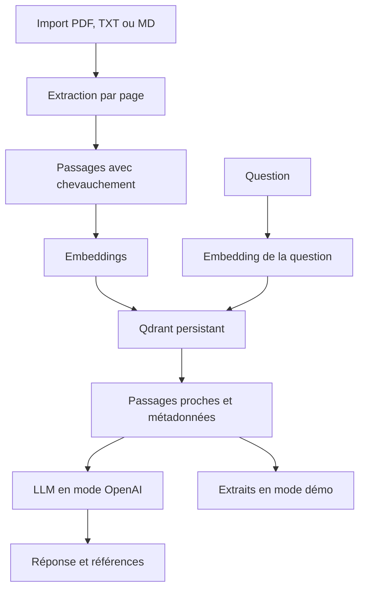

# Documind — assistant RAG sur documents

Projet portfolio : extraction PDF/TXT/MD → découpage → embeddings → Qdrant → recherche → modèle de langage → réponse avec références et passages consultables.

## Démarrage avec Docker

Prérequis : Docker avec Compose. Depuis ce dossier :

```bash
cp .env.example .env
docker compose up --build
```

Ouvrir http://localhost:8000. Documentation de l'API : http://localhost:8000/docs.

Le mode par défaut `demo` ne nécessite ni clé ni téléchargement de modèle. Importer les fichiers du dossier `examples`, puis demander « Quelle est la conservation des sauvegardes PostgreSQL ? ». L'interface affiche les passages retrouvés et indique explicitement qu'aucune réponse de LLM n'est générée. Ces deux documents sont fictifs, créés pour cette démonstration ; ils ne décrivent aucune organisation réelle.

Le volume nommé `rag_storage` conserve l'index Qdrant après arrêt du conteneur. L'import est manuel, sans indexation automatique de fichiers personnels. Docker n'a pas été exécuté dans l'environnement de création ; le Dockerfile et Compose restent à vérifier au lancement.

## Activer le RAG sémantique et la génération

Modifier `.env` localement :

```dotenv
RAG_MODE=openai
OPENAI_API_KEY=votre_cle_a_renseigner_localement
OPENAI_MODEL=gpt-4.1-mini
EMBEDDING_MODEL=text-embedding-3-small
MIN_SCORE=0.20
```

Puis relancer :

```bash
docker compose up --force-recreate
```

Ne jamais partager ni committer la clé. Elle reste côté serveur et n'est pas renvoyée au navigateur. Les appels peuvent être facturés par le fournisseur ; l'accès aux modèles dépend du compte. Aucun appel OpenAI réel n'a été effectué lors de la création du projet.

**Il faut réimporter les documents après un changement de mode ou de modèle d'embeddings.** Les collections Qdrant sont séparées par signature (fournisseur, modèle, dimensions, version du découpage). Un changement ne mélange donc pas des vecteurs incompatibles et ne supprime pas l'ancien index. La suppression d'un document dans l'interface concerne uniquement la collection active. Les anciennes collections restent présentes sur le volume.

En mode OpenAI, le texte des documents est envoyé à l'API d'embeddings lors de l'indexation. Chaque question et les passages retrouvés sont envoyés au modèle pour la génération. L'option `store=false` est transmise à l'API Responses ; elle ne constitue pas une promesse d'absence de conservation technique par le fournisseur. Les embeddings et extraits restent également dans le stockage Qdrant local.

## Installation native

Python 3.12 recommandé.

```bash
python -m venv .venv
. .venv/bin/activate
pip install -r requirements-dev.txt
pytest -q
uvicorn main:app --host 127.0.0.1 --port 8000 --workers 1
```

Sous Windows, activer `.venv\Scripts\activate`. Pour activer OpenAI en installation native, exporter les mêmes variables dans le processus qui lance Uvicorn ; le fichier `.env` n'est chargé automatiquement que par Docker Compose. Sous Bash : `set -a; source .env; set +a` après avoir renseigné le fichier.

Utiliser **un seul processus et un seul worker** : Qdrant est ici en mode embarqué avec verrou sur le répertoire. Ne pas lancer plusieurs instances sur le même stockage. Le verrou applicatif sérialise les opérations d'indexation, de recherche et de suppression ; cette version vise une petite démonstration, pas une charge importante.

## Architecture



- `ingestion.py` : nettoyage du nom, extraction et SHA-256 du document, découpage par page de 180 mots avec 30 mots de chevauchement. Les pages des textes/Markdown sont indiquées comme page 1.
- `providers.py` : embeddings lexicaux par hashing normalisé en démo (2 048 dimensions), embeddings OpenAI en mode sémantique (1 536 dimensions), appel Responses et contrôle syntaxique des références.
- `store.py` : Qdrant embarqué, distance cosinus, métadonnées document/page/passage, dédoublonnage par empreinte du fichier, recherche et suppression.
- `main.py` : API FastAPI, validation et service de l'interface.
- `web/` : interface responsive, import, bibliothèque, questions et extraits dépliables. Le texte est inséré avec `textContent`, sans interpréter le HTML des documents ou du modèle.

Les données brutes ne sont pas conservées comme fichiers : Qdrant conserve le texte extrait, les vecteurs et les métadonnées. Un fichier identique renommé est un doublon ; un fichier modifié est un nouveau document, à supprimer séparément si nécessaire. Une ancienne réponse peut refléter un état ancien du corpus ; l'interface efface son historique affiché lors d'une suppression.

## Réponses et sources

Les questions sont indépendantes : l'historique affiché dans l'onglet n'est pas transmis au modèle. Il faut reformuler les questions de suivi de manière autonome.

La recherche ramène jusqu'à quatre passages par défaut, six au maximum. Le seuil `MIN_SCORE` est appliqué avant génération. Il représente une similarité, jamais un niveau de confiance ; il doit être calibré sur votre corpus et votre modèle. Si aucun passage ne franchit le seuil, le LLM n'est pas appelé. Un passage proche ne garantit pas que la réponse est présente.

Le prompt exige une réponse fondée sur les extraits, des références `[S1]`, `[S2]` et la reconnaissance de l'absence de preuve. Les instructions présentes dans les documents sont traitées comme des données non fiables. Le serveur rejette les réponses sans référence reconnue, contenant un identifiant inexistant, ou les générations incomplètes. Ce contrôle vérifie la forme des citations, **pas la vérité de chaque affirmation ni la résistance absolue aux injections**. Toutes les sources retrouvées sont affichées ; une source affichée n'est pas nécessairement citée par le modèle.

## Limites de la démonstration

- 10 Mo par fichier, 100 pages par PDF, 400 passages par document, 100 documents ou 10 000 passages par collection.
- PDF texte uniquement : aucun OCR, extraction de tableaux non garantie, rejet des PDF chiffrés.
- Recherche lexicale en démo : pas de compréhension sémantique, collisions de hashing possibles, difficultés sur synonymes et paraphrases.
- Aucun reranking, streaming, isolation multiutilisateur ni authentification. L'application est exposée uniquement sur `127.0.0.1` par Compose. Ne pas publier cette instance partagée telle quelle.
- Le mode Qdrant local ne vise pas un service multi-instance. Pour un déploiement partagé, prévoir Qdrant serveur, authentification, séparation des corpus et limites au niveau du serveur HTTP.
- Les traitements sont bornés pour une démonstration, sans garantie de résistance à des fichiers malveillants ; utiliser des documents de confiance.
- Les opérations Qdrant ne sont pas présentées comme des transactions applicatives avec rollback automatique.

## API

| Route | Usage |
|---|---|
| `GET /api/status` | Mode, signature d'embeddings, documents actifs |
| `POST /api/documents` | Import multipart avec champ `file` |
| `DELETE /api/documents/{id}` | Suppression des passages du document actif |
| `POST /api/ask` | Question, réponse et sources ; `generated` indique si un LLM a répondu |
| `GET /docs` | Documentation interactive |

```bash
curl -F file=@examples/guide-projet.txt http://localhost:8000/api/documents
curl -X POST http://localhost:8000/api/ask \
  -H 'Content-Type: application/json' \
  -d '{"question":"Quelle est la conservation des sauvegardes PostgreSQL ?","k":4}'
```

## Validation réalisée

**13 tests passent** : parcours import/recherche/suppression, doublons, formats invalides, corpus vide, question éloignée, chevauchement, nom de fichier, PDF sans texte, PDF texte sur deux pages et numéro de page, persistance et séparation des modèles. L'adaptateur OpenAI et le chemin de génération sont testés avec un fournisseur ou des réponses HTTP simulés, sans appel réseau payant. La syntaxe JavaScript et la compilation des modules Python ont été vérifiées.

Le rendu visuel dans un navigateur, la construction Docker et l'intégration réelle OpenAI restent à vérifier. Les versions directes sont épinglées ; les dépendances transitives ne sont pas verrouillées.

```bash
python evaluate.py
```

Cette évaluation locale reconstruit un index temporaire des deux exemples et vérifie six questions préparées à la main. **5/6 cas réussissent** avec le seuil 0,20. La question sur les PDF scannés et l'OCR n'atteint pas le seuil lexical. Le rapport détaillé est dans `evaluation.json`. Ce petit contrôle ne mesure ni la qualité générale de recherche ni la fidélité d'un LLM. Pour un vrai portfolio, ajouter un corpus autorisé et un jeu de questions annotées, puis mesurer rappel des passages pertinents, fidélité des réponses et abstentions en mode sémantique.

## Documentation utilisée

- Qdrant Python, fonctionnement local et persistance : https://github.com/qdrant/qdrant-client
- Embeddings OpenAI : https://developers.openai.com/api/reference/resources/embeddings/methods/create
- Responses OpenAI : https://developers.openai.com/api/reference/python/resources/responses/methods/create

Les documents fournis dans `examples` sont des exemples originaux fictifs ; aucun document personnel n'est inclus.
